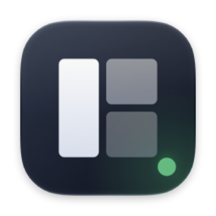
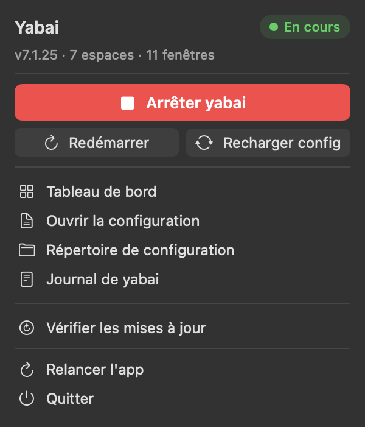
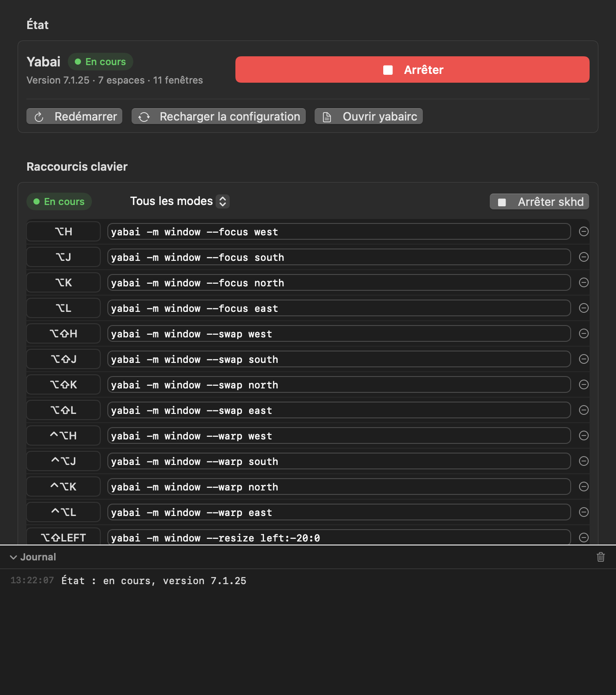
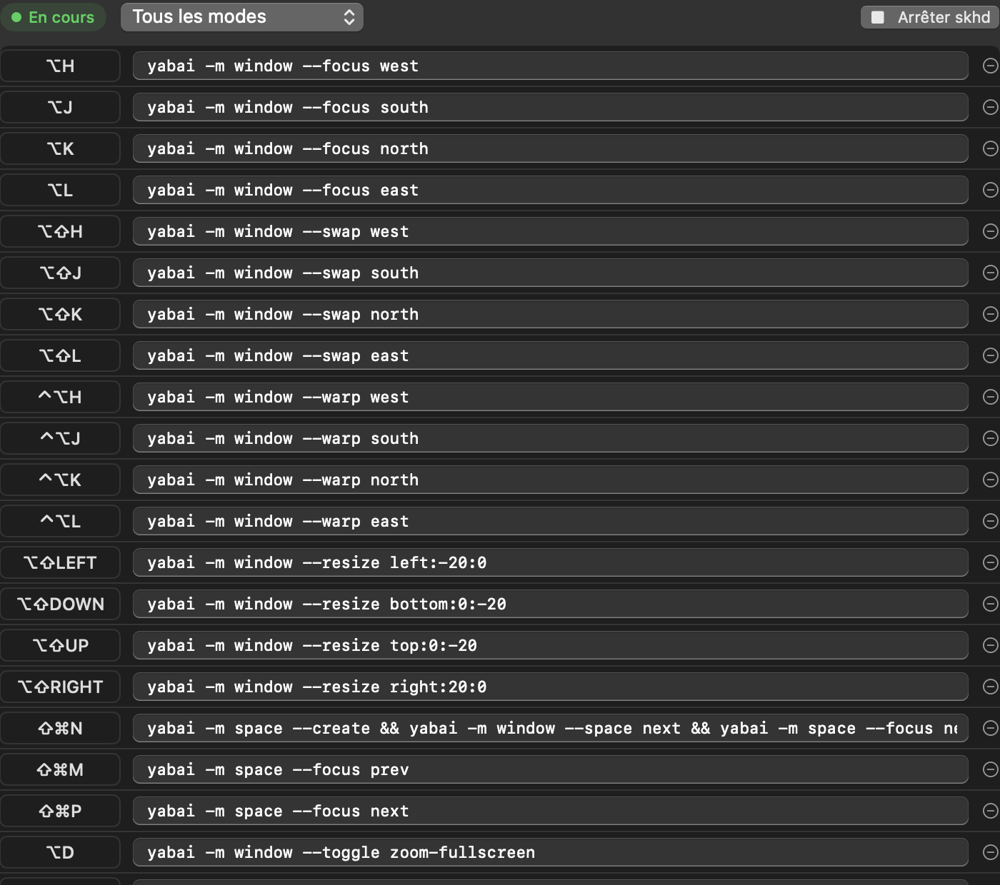

# YabaiBar

Un compagnon de barre de menus pour [yabai](https://github.com/asmvik/yabai) et
[skhd](https://github.com/asmvik/skhd) : démarrer, arrêter, configurer et mettre à jour
ton gestionnaire de fenêtres tuilé, sans ouvrir de terminal.



YabaiBar est une **app accessory** : elle vit dans la barre de menus et n'a pas d'icône dans
le Dock. Le glyphe de la barre de menus représente une partition binaire de l'espace et
change de couleur selon l'état de yabai — vert quand il tourne, gris quand il est arrêté,
bleu pendant une opération.



## Installer

```sh
brew install --cask yabaibar
```

Ou depuis un tap, si le cask n'est pas encore dans homebrew/cask :

```sh
brew tap remixeco/tap
brew install --cask remixeco/tap/yabaibar
```

Compiler depuis les sources :

```sh
git clone https://github.com/remixeco/YabaiBar.git
cd YabaiBar
./Scripts/build.sh
```

Le script compile l'app, génère l'icône, assemble le bundle, le signe et l'installe dans
`/Applications`.

yabai et skhd ne sont **pas** inclus : installe-les comme d'habitude.

```sh
brew install asmvik/formulae/yabai
brew install asmvik/formulae/skhd
```

## Ce qu'elle fait

### Panneau de la barre de menus

- Démarrer, arrêter et redémarrer yabai
- Recharger la configuration
- Ouvrir la configuration, son dossier et les journaux
- Vérifier les mises à jour, relancer l'app, quitter

### Tableau de bord <kbd>⌘D</kbd>



**État** — version, nombre d'espaces et de fenêtres, état du service launchd.

**Raccourcis clavier** — un éditeur complet de ton `skhdrc`.



- Vue structurée : clique sur une case, appuie sur la combinaison voulue, édite la
  commande. Filtres par mode, ajout et suppression de raccourcis.
- Vue texte : édition directe du fichier `skhdrc`.
- L'enregistrement redémarre skhd : les raccourcis sont actifs immédiatement.

**Réglages** — disposition, placement, écart et marges. Appliqués à l'instance en cours,
ou écrits dans `yabairc`.

**Mises à jour** — lance `brew update` puis `brew upgrade yabai`, et redémarre le service
pour que le nouveau binaire soit chargé.

**Diagnostic** — chemins, état du service, lancement au démarrage, et le journal en direct.

## Raccourcis de l'app

| Raccourci | Action |
| --- | --- |
| `⌘D` | Ouvrir le tableau de bord |
| `⇧⌘R` | Relancer l'app |
| `⌘Q` | Quitter |

## Fichiers utilisés

| Ressource | Chemin |
| --- | --- |
| Configuration yabai | `~/.config/yabai/yabairc` |
| Configuration skhd | `~/.config/skhd/skhdrc` |
| Agent launchd yabai | `~/Library/LaunchAgents/com.asmvik.yabai.plist` |
| Agent launchd skhd | `~/Library/LaunchAgents/com.koekeishiya.skhd.plist` |
| Journaux | `/tmp/yabai_<user>.{out,err}.log`, `/tmp/skhd_<user>.{out,err}.log` |

yabai est piloté par sa propre API de service : `--install-service`, `--start-service`,
`--stop-service` et `--restart-service`.

> **À noter** — yabai ne recharge pas `yabairc` à chaud : la configuration est sourcée au
> démarrage du service. « Recharger la configuration » redémarre donc le service.

## Autorisation Accessibilité

yabai et skhd ont besoin de l'API Accessibilité. macOS la demande au premier démarrage de
chaque daemon. Si skhd refuse de démarrer avec
`must be run with accessibility access`, le tableau de bord affiche un bouton
**Autoriser** qui ouvre le bon panneau de réglages.

## Développement

```sh
swift build -c release          # compiler
./Scripts/build.sh              # compiler, signer et installer
./Scripts/build.sh --no-install # compiler seulement
./Scripts/screenshots.sh        # régénérer les images de docs/
```

L'icône est du code : `Scripts/make_icon.swift` la dessine de zéro en CoreGraphics
(superellipse, dégradé, glyphe BSP), ce qui la garde nette à toutes les tailles et évite
tout binaire dans le dépôt.

Les captures d'écran sont rendues par l'app elle-même (`YabaiBar --screenshots docs`), donc
elles correspondent toujours au code.

## Licence

MIT — voir [LICENSE](LICENSE).
