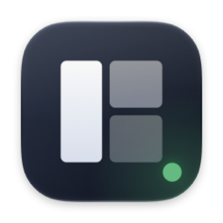
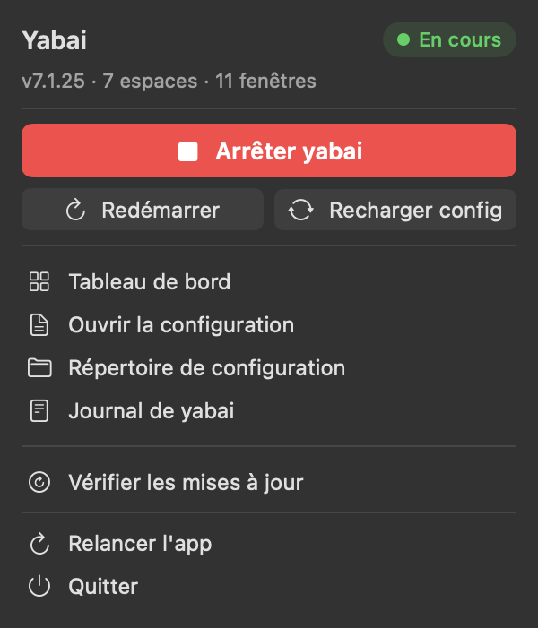
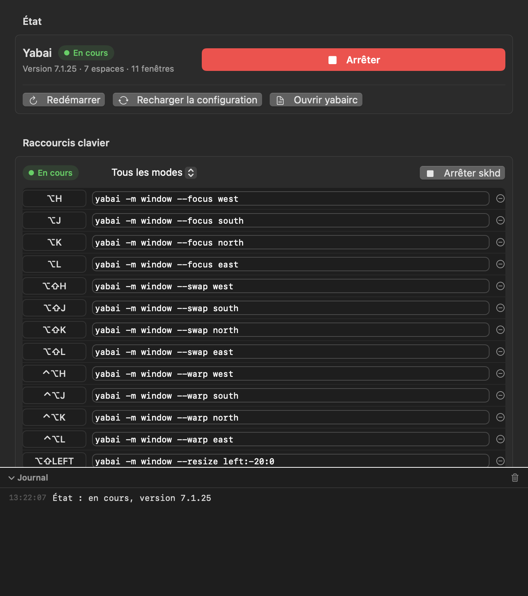
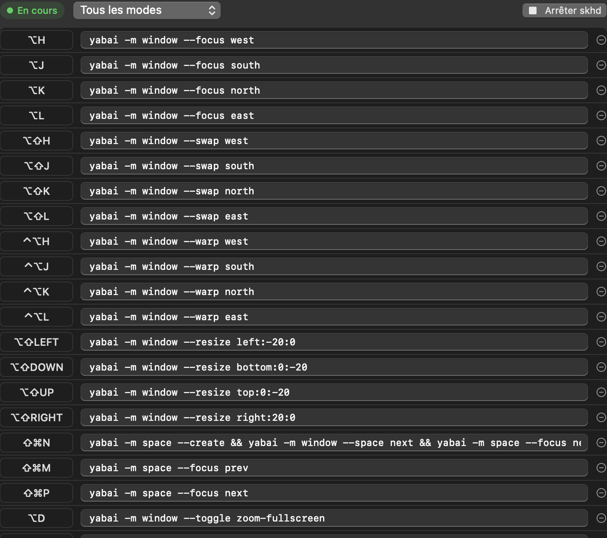

# YabaiBar

A menu bar companion for [yabai](https://github.com/asmvik/yabai) and
[skhd](https://github.com/asmvik/skhd) — start, stop, configure and update
your tiling window manager without opening a terminal.



YabaiBar is an **accessory app**: it lives in the menu bar and has no Dock
icon. The menu bar glyph is a binary space partitioning layout that changes
colour with the state of yabai — green when it runs, grey when it is stopped,
blue while something is happening.



## Install

```sh
brew install --cask yabaibar
```

Or from a tap, if the cask has not reached homebrew/cask yet:

```sh
brew tap remixeco/tap
brew install --cask remixeco/tap/yabaibar
```

Building from source:

```sh
git clone https://github.com/remixeco/YabaiBar.git
cd YabaiBar
./Scripts/build.sh
```

The build script compiles the app, renders the icon, assembles the bundle,
signs it and installs it into `/Applications`.

yabai and skhd themselves are **not** bundled; install them the usual way:

```sh
brew install asmvik/formulae/yabai
brew install asmvik/formulae/skhd
```

## What it does

### Menu bar panel

- Start, stop and restart yabai
- Reload the configuration
- Open the configuration, its folder and the logs
- Check for updates, relaunch the app, quit

### Dashboard <kbd>⌘D</kbd>



**State** — version, number of spaces and windows, launchd service status.

**Keyboard shortcuts** — a complete editor for your `skhdrc`.



- Structured view: click a cell, press the key combination you want, edit the
  command. Modes can be filtered, bindings added and removed.
- Raw text view: edit the `skhdrc` file directly.
- Saving restarts skhd so the shortcuts take effect immediately.

**Settings** — layout, placement, gap and padding. Apply them to the running
instance, or write them to `yabairc`.

**Updates** — runs `brew update` and `brew upgrade yabai`, then restarts the
service so the new binary is the one running.

**Diagnostics** — paths, service state, launch at login, and a live log of
everything the app did.

## Keyboard shortcuts of the app

| Shortcut | Action |
| --- | --- |
| `⌘D` | Open the dashboard |
| `⇧⌘R` | Relaunch the app |
| `⌘Q` | Quit |

## Files it touches

| Resource | Path |
| --- | --- |
| yabai configuration | `~/.config/yabai/yabairc` |
| skhd configuration | `~/.config/skhd/skhdrc` |
| yabai launch agent | `~/Library/LaunchAgents/com.asmvik.yabai.plist` |
| skhd launch agent | `~/Library/LaunchAgents/com.koekeishiya.skhd.plist` |
| Logs | `/tmp/yabai_<user>.{out,err}.log`, `/tmp/skhd_<user>.{out,err}.log` |

yabai is driven through its own service API: `--install-service`,
`--start-service`, `--stop-service` and `--restart-service`.

> **Note** — yabai does not reload `yabairc` on the fly; the configuration is
> sourced when the service starts. "Reload the configuration" therefore
> restarts the service.

## Accessibility permissions

yabai and skhd both need the Accessibility API. macOS asks for it the first
time each daemon starts. If skhd refuses to start with
`must be run with accessibility access`, the dashboard shows an **Authorize**
button that opens the right settings pane.

## Development

```sh
swift build -c release          # compile
./Scripts/build.sh              # build, sign and install
./Scripts/build.sh --no-install # build only
./Scripts/screenshots.sh        # regenerate the images in docs/
```

The icon is code: `Scripts/make_icon.swift` draws it from scratch with
CoreGraphics (superellipse, gradient, BSP glyph), which keeps it sharp at
every size and keeps binaries out of the repository.

The screenshots are rendered by the app itself
(`YabaiBar --screenshots docs`), so they always match the code.

`Scripts/click.swift` and `Scripts/find_icon.swift` are small helpers used to
drive and inspect the menu bar item while debugging; they are handy if you
change how the status item is drawn.

## License

MIT — see [LICENSE](LICENSE).
