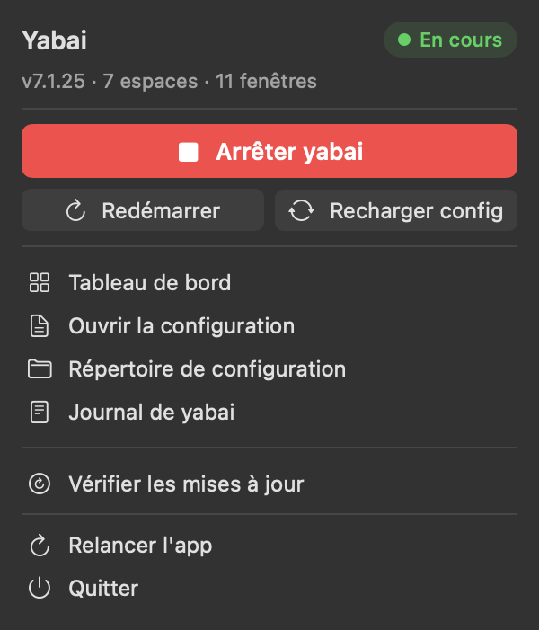
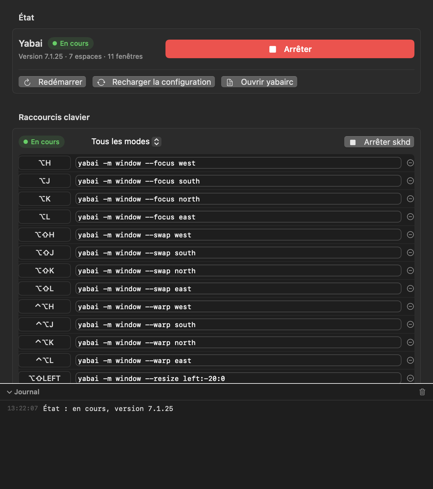

yabai is driven from the command line. The projects below wrap it in a
graphical interface. They are maintained by the community and are not part of
yabai.

| Project | What it does |
|---|---|
| [YabaiBar](https://github.com/remixeco/YabaiBar) | Menu bar app that starts, stops and updates yabai and skhd, and edits both configuration files |
| [YabaiIndicator](https://github.com/xiamaz/YabaiIndicator) | Menu bar applet that shows the current space and switches between spaces |
| [yabai-help-overlay](https://github.com/arunvelsriram/yabai-help-overlay) | Help overlay listing the available keybindings |
| [yabai-uberbar](https://github.com/AdamWagner/yabai-uberbar) | Übersicht bar with a graphical overview of the windows on each space |
| [yabai-status-bar](https://github.com/qhuyduong/yabai-status-bar) | Übersicht widget with a status bar for yabai |
| [yabai-dockstack](https://github.com/z20240/yabai-dockstack) | Stack indicators and cross-space window decorations |

## YabaiBar

An accessory app — it lives in the menu bar and has no Dock icon. It manages
the yabai and skhd services, edits `yabairc` and `skhdrc`, and updates yabai
through Homebrew.

### Installation

```sh
brew install --cask yabaibar
```

### Screenshots





### Details

- Starts, stops and restarts yabai from the menu bar.
- Edits the skhd shortcuts with a key recorder, or as raw text.
- Applies the layout, placement, gap and padding live, or writes them to
  `yabairc`.
- Updates yabai with `brew upgrade` and restarts the service.
- Shows the yabai and skhd logs.

### Repository

[github.com/remixeco/YabaiBar](https://github.com/remixeco/YabaiBar)
